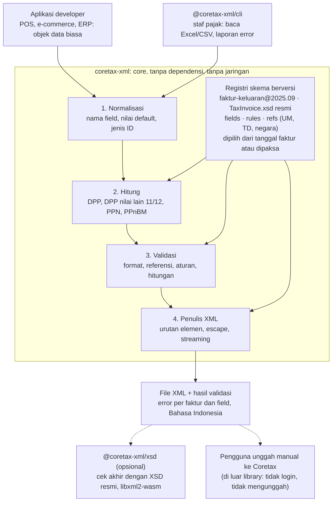
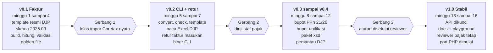

# PRD coretax-xml: Library Impor XML Coretax DJP

5 November 2026 · cuikww

> Dikonversi dari dokumen PRD di Claude. Isi tidak diubah, kecuali diagram yang ditulis ulang sebagai Mermaid dan bagian *Status implementasi* di bawah. Keputusan teknis selama implementasi ada di [DECISIONS.md](DECISIONS.md).

## Status implementasi

Per 6 November 2026: `coretax-xml` dan `@coretax-xml/cli` 0.1.0 (draf, belum terbit di npm). v0.2 dikerjakan sebelum Gerbang 1 lolos atas keputusan maintainer; rilis publik tetap menunggu Gerbang 1.

| Fase | Status |
| --- | --- |
| v0.1 Faktur | 🟡 Kode core, hitung, validasi, dan writer XML ada dengan 46 test. Paket resmi DJP (converter v1.6, template v1.6.1) sudah diunduh; tabel referensi dan urutan elemen dicocokkan, output sama dengan sampel resmi v1.4. **Belum**: golden file dari converter, uji impor nyata (Gerbang 1) |
| v0.2 CLI + retur | 🟡 Ada: `check()` di core (F3.6); paket CLI dengan `convert` (template Excel DJP dan CSV), `check`, `template`, `schemas`, laporan teks/JSON/HTML, error menunjuk baris Excel; biner mandiri (workflow manual); **retur faktur pajak masukan** (`returMasukan.build/validate/check`, template Excel retur DJP lewat CLI). Output `convert` faktur sama dengan converter DJP untuk 10 kasus uji; retur dicocokkan dengan sampel resmi dan dengan converter DJP untuk 3 retur plus probe pembulatan `.50` (golden file), tetapi belum diuji impor. **Sudah** `buildStream` dan `--maks-per-file` (F1.5, F1.6) serta nama field Inggris untuk faktur keluaran (F1.1) dan katalog kode error `errors/katalog.json`. **Sudah** juga CSV untuk retur dan retur di paket uji impor. **Belum**: validasi XSD (DJP tidak menerbitkan), Gerbang 2 (diuji staf pajak) |
| v0.3 sampai v0.4 Bupot | Belum dimulai |
| v1.0 Stabil | Belum dimulai |

## Ringkasan

`coretax-xml` (nama sementara) adalah library open source TypeScript untuk membuat dan memvalidasi file XML impor Coretax DJP langsung dari data aplikasi, tanpa lewat template Excel dan aplikasi converter resmi.

**Masalah**: sejak Coretax berlaku pada 2025, pembuatan faktur pajak dan bukti potong dalam jumlah banyak dilakukan lewat impor XML. Jalur resminya adalah mengisi template Excel DJP lalu mengubahnya dengan aplikasi converter. Template dan converter ini berubah berkali-kali, dan pesan errornya merujuk ke nomor baris XML sehingga sulit dipahami.

**Solusi**: satu library yang dipanggil dari kode aplikasi (POS, e-commerce, ERP, software akuntansi) untuk:

1. Membuat XML faktur pajak keluaran dan bukti potong dari objek data biasa
2. Memvalidasi sebelum diunggah, dengan pesan error per field dalam Bahasa Indonesia
3. Mengikuti versi template DJP lewat skema berversi
4. Menyediakan CLI untuk mengubah CSV/Excel menjadi XML bagi non-programmer

**Rilis pertama (v0.1)**: faktur pajak keluaran saja, karena paling banyak dipakai dan formatnya paling banyak dibahas.

## Latar belakang & bukti masalah

Format impor Coretax berubah beberapa kali dalam 2025, pesan errornya sulit dibaca, dan per 5 November 2026 belum ada library npm maupun PyPI untuk membuatnya.

| Bukti | Detail | Sumber |
| --- | --- | --- |
| Converter berubah | Converter XML v1.5 (Maret 2025): perbaikan format tanggal retur masukan, parameter baru untuk kode transaksi 07, perbaikan kolom `CustomRefDoc` yang bergeser | [DDTC, 6 Mar 2025](https://news.ddtc.co.id/berita/nasional/1809266/djp-luncurkan-aplikasi-converter-xml-versi-15) |
| Template berubah | Template Excel v1.6 (September 2025): kode keterangan tambahan baru TD.00513 dan TD.00524, cap fasilitas TD.01113, satuan baru UM.0034 sampai UM.0039 | [DDTC, 24 Sep 2025](https://news.ddtc.co.id/berita/nasional/1813944/perhatian-ada-update-template-excel-faktur-pajak-keluaran) |
| Sampel resmi tidak konsisten | Sampel v1.4 memakai `BuyerCountry` = `IND` dan tarif 11, sedangkan referensi v1.6.1 menjadikan `IND` = India, Indonesia = `IDN`, dan contoh tarif 12 dengan DPP nilai lain | [Sipajak, diperbarui 29 Okt 2026](https://www.sipajak.com/post/format-xml-faktur-pajak-coretax) |
| Error sulit dipahami | Impor gagal menampilkan "Invoices have errors!" dengan nomor baris XML, bukan baris Excel; error umum "NITKU pembeli tidak valid" karena salah pasangan Jenis ID dan ID TKU | [DDTC, 17 Feb 2025](https://news.ddtc.co.id/review/konsultasi-coretax/1808895/faktur-xml-cuma-15-baris-tapi-erornya-100-baris-lebih-apa-yang-salah) |
| Kode lama tertinggal | Skrip Zoho Books untuk Coretax (Januari 2025) tidak punya elemen `CustomDocMonthYear` yang ada di format terbaru | [raw-dani/Coretax-XML-for-Zohobooks-Invoice](https://github.com/raw-dani/Coretax-XML-for-Zohobooks-Invoice) |
| Belum ada library | Nama `coretax` dan `coretax-xml` belum terpakai di npm dan PyPI; yang ada hanya modul Odoo dan skrip per platform | npm/PyPI registry, [modul Odoo](https://apps.odoo.com/apps/modules/18.0/coretax) |

Pembanding: Polandia (KSeF) dan Jerman/Prancis (Factur-X, ZUGFeRD) sudah punya banyak library e-invoicing di npm. Indonesia belum.

## Tujuan, non-tujuan, dan metrik

Tujuan utama: developer bisa menghasilkan XML faktur yang lolos impor Coretax pada percobaan pertama, langsung dari data aplikasinya.

**Tujuan**

- Membuat XML faktur pajak keluaran, lalu retur dan bukti potong, sesuai versi template DJP yang berlaku
- Validasi lengkap sebelum unggah: format, kode referensi, aturan antar-field, dan hitungan PPN
- Pesan error per faktur dan per field dalam Bahasa Indonesia, dengan saran perbaikan
- Mendukung beberapa versi template sekaligus, dengan tanggal berlaku masing-masing
- CLI untuk mengubah CSV/Excel menjadi XML tanpa menulis kode
- Berjalan sepenuhnya lokal: data NPWP dan transaksi tidak dikirim ke mana pun

**Non-tujuan**

- Bukan klien API Coretax dan tidak mengunggah atau login ke Coretax atas nama pengguna
- Bukan PJAP (Penyedia Jasa Aplikasi Perpajakan) dan tidak menerbitkan nomor seri faktur
- Tidak menentukan kewajiban pajak pengguna (kode transaksi mana yang benar untuk transaksinya); library hanya memeriksa konsistensi
- Bukan software akuntansi atau pembuat SPT lengkap
- Bukan nasihat pajak (lihat bagian Lisensi & legal)

**Metrik keberhasilan (6 bulan setelah v1.0)**

| Metrik | Target |
| --- | --- |
| XML hasil library yang lolos validasi Coretax, diuji dengan sampel nyata | 100% dari kasus uji |
| Jeda rilis skema baru setelah DJP merilis template baru | maksimal 7 hari |
| Unduhan npm | 1.000/bulan |
| Aplikasi/ERP yang memakai (diketahui dari issue atau showcase) | minimal 5 |
| Kontributor yang paham pajak (konsultan, staf pajak) | minimal 1 reviewer tetap |

## Pengguna sasaran & user stories

Pengguna utama adalah developer yang membangun sistem penjualan untuk pengusaha kena pajak (PKP); pengguna kedua adalah staf pajak yang memakai CLI.

| Persona | Konteks | Kebutuhan utama |
| --- | --- | --- |
| Developer e-commerce / POS | Toko online, kasir, B2B ordering (misalnya Cakra) | Tombol "Ekspor faktur Coretax" dari data pesanan |
| Developer ERP / akuntansi | Software akuntansi lokal, integrasi Odoo, Zoho, Accurate | Library stabil yang mengikuti perubahan DJP tanpa ditulis ulang |
| Freelancer / agensi | Sistem custom untuk klien PKP (misalnya Arsana Dev) | Fitur pajak siap pakai sebagai nilai jual |
| Staf pajak / admin keuangan | Punya data penjualan di Excel atau CSV | Ubah file menjadi XML tanpa converter DJP, dengan error yang jelas |
| Konsultan pajak | Mengurus banyak klien | Validasi massal file klien sebelum diunggah |

**User stories**

1. Sebagai developer, saya memanggil `buildFakturKeluaran(data)` dan mendapat string XML yang siap diunggah ke Coretax.
2. Sebagai developer, saya memanggil `validate(data)` dan mendapat daftar error per faktur dan per field, bukan per baris XML.
3. Sebagai developer, saya memilih versi template (`schema: '2025.09'`) atau membiarkan library memilih versi yang berlaku pada tanggal faktur.
4. Sebagai developer, saya cukup mengisi harga dan jumlah; DPP, DPP nilai lain 11/12, dan PPN dihitung otomatis dengan pembulatan yang benar.
5. Sebagai developer, saya mendapat tipe TypeScript lengkap sehingga editor memberi tahu field yang wajib.
6. Sebagai staf pajak, saya menjalankan `npx coretax-xml convert penjualan.xlsx` dan mendapat file XML plus laporan error yang mudah dibaca.
7. Sebagai staf pajak, saya bisa memecah ribuan faktur menjadi beberapa file XML jika Coretax membatasi jumlah per file (batasnya perlu dikonfirmasi).
8. Sebagai konsultan, saya menjalankan `coretax-xml check folder/` untuk memeriksa XML buatan aplikasi lain.
9. Sebagai developer, saya diberi tahu (lewat changelog dan peringatan) saat DJP merilis template baru yang memengaruhi data saya.
10. Sebagai developer PHP/Laravel, saya memakai versi PHP dengan perilaku dan pesan error yang sama (setelah v1.0).

## Cakupan dokumen Coretax

v0.1 hanya faktur pajak keluaran; jenis dokumen lain ditambahkan satu per satu setelah strukturnya diverifikasi dari template resmi DJP.

| Dokumen | Template DJP yang diketahui | Struktur sudah diverifikasi? | Rilis |
| --- | --- | --- | --- |
| Faktur pajak keluaran | Sample Faktur PK Template v1.4, Excel v1.6.1, root `TaxInvoiceBulk` | Ya, dari dua sumber independen | v0.1 |
| Retur faktur pajak masukan | Sample Retur Faktur PM Template v1.1 | Belum | v0.2 |
| Bukti potong PPh 21/26 | Template dan converter bupot di halaman DJP | Belum | v0.3 |
| Bukti potong unifikasi | Template dan converter bupot di halaman DJP | Belum | v0.4 |
| Lampiran C SPT Masa PPN | Sample Lampiran C Template v1.1 | Belum | dievaluasi setelah v1.0 |
| Impor data SPT Tahunan PPh Badan (mis. daftar aset) | Converter XML SPT PPh Badan | Belum | dievaluasi setelah v1.0 |

Sebelum mengerjakan tiap jenis dokumen, unduh paket template resmi dari halaman DJP [Template XML dan Converter Excel ke XML](https://www.pajak.go.id/id/reformdjp/coretax/template-xml-dan-converter-excel-ke-xml) dan simpan XSD serta sampelnya di folder `fixtures/` sebagai acuan.

## Kebutuhan fungsional

Kebutuhan dibagi ke 5 kelompok; semua kelompok kecuali F5 masuk v0.1 untuk faktur pajak keluaran.

### F1. Pembuatan XML (builder)

- F1.1 Menerima objek data bernama jelas dalam Bahasa Indonesia atau Inggris (mis. `pembeli.npwp` atau `buyer.tin`) dan menulisnya ke elemen DJP (`BuyerTin`)
- F1.2 Menghasilkan root `TaxInvoiceBulk` dengan `TIN` penjual dan `ListOfTaxInvoice` berisi satu atau banyak `TaxInvoice`, masing-masing dengan `ListOfGoodService`
- F1.3 Urutan elemen, elemen kosong (mis. `<AddInfo/>`), format tanggal `YYYY-MM-DD`, dan angka maksimal 2 desimal sesuai sampel resmi
- F1.4 Mengisi nilai baku otomatis: `TaxInvoiceOpt` = `Normal`, `BuyerTin` = 16 nol dan `BuyerIDTKU` = `000000` jika pembeli bukan pemilik NPWP, `BuyerDocumentNumber` = `-` jika Jenis ID = `TIN`
- F1.5 Mode streaming untuk ribuan faktur tanpa memuat semuanya ke memori
- F1.6 Opsi memecah output menjadi beberapa file

### F2. Perhitungan

- F2.1 Menghitung `TaxBase` (DPP) dari harga, jumlah, dan diskon
- F2.2 Menghitung `OtherTaxBase` (DPP nilai lain) dengan koefisien 11/12 untuk kasus yang diatur PMK 131/2024, atau sama dengan DPP jika tidak dipakai
- F2.3 Menghitung `VAT` = tarif × DPP nilai lain, dan PPnBM jika ada
- F2.4 Aturan pembulatan dapat diatur, default pembulatan komersial 2 desimal; aturan resmi perlu dikonfirmasi (lihat Risiko)
- F2.5 Mode `strict`: pengguna mengisi semua angka sendiri, library hanya memeriksa

### F3. Validasi

- F3.1 Validasi struktur terhadap XSD resmi DJP (`TaxInvoice.xsd`) untuk versi skema yang dipilih
- F3.2 Validasi format: NPWP 16 digit, NITKU 22 digit, kode negara, tanggal, desimal
- F3.3 Validasi kode referensi: kode transaksi 01 sampai 10, satuan UM.xxxx, kode barang/jasa, keterangan tambahan TD.005xx, cap fasilitas TD.011xx, negara
- F3.4 Aturan antar-field: kode transaksi 07/08 wajib `AddInfo` dan `FacilityStamp`; pasangan Jenis ID Pembeli dan ID TKU; PPN harus sama dengan tarif × DPP nilai lain untuk kode 01, 04, 09
- F3.5 Hasil validasi berupa daftar error dan peringatan dengan lokasi (faktur ke-n, item ke-m, field), kode error stabil, pesan Bahasa Indonesia, dan saran perbaikan
- F3.6 Memeriksa file XML yang sudah ada (buatan converter DJP atau aplikasi lain)

### F4. Skema berversi

- F4.1 Setiap versi template DJP disimpan sebagai satu paket skema (struktur, XSD, tabel kode referensi, aturan) dengan tanggal mulai berlaku
- F4.2 Pemilihan otomatis berdasarkan tanggal faktur, atau dipaksa ke versi tertentu
- F4.3 Tabel referensi (satuan, negara, kode TD) bisa dibaca developer, mis. untuk mengisi dropdown di aplikasinya

### F5. CLI

- F5.1 `coretax-xml convert <file.csv|xlsx>`: mengubah file tabular menjadi XML, mendukung template Excel resmi DJP dan format CSV sederhana
- F5.2 `coretax-xml check <file.xml|folder>`: validasi file yang sudah ada
- F5.3 `coretax-xml template`: membuat contoh CSV/Excel kosong dengan kolom yang benar
- F5.4 Laporan error dalam format teks, JSON, dan HTML
- F5.5 Berjalan tanpa internet

## Kebutuhan non-fungsional

Kebutuhan terpenting adalah keamanan data: NPWP, NIK, nama, dan alamat pembeli adalah data pribadi, jadi library tidak boleh mengirim data ke luar perangkat dalam kondisi apa pun.

| Area | Kebutuhan | Target |
| --- | --- | --- |
| Privasi | Tanpa panggilan jaringan, tanpa telemetri, tanpa log data pengguna | wajib, diuji di CI |
| Privasi | Pesan error menyamarkan NIK/NPWP (mis. `3201********0001`) secara default | wajib |
| Akurasi | Angka memakai aritmetika desimal, bukan floating point JavaScript | wajib |
| Performa | 10.000 faktur × 5 item dibuat dan divalidasi | di bawah 5 detik di laptop biasa (perkiraan, diukur saat prototipe) |
| Memori | Mode streaming untuk file besar | di bawah 200 MB untuk 100.000 faktur (perkiraan) |
| Kompatibilitas | Node.js 20+, Bun, Deno, browser modern (untuk aplikasi tanpa backend) | wajib |
| Modul | ESM + CJS, tipe TypeScript disertakan, tree-shakeable per jenis dokumen | wajib |
| Dependensi | Seminimal mungkin dan diaudit; tidak ada dependensi yang mengirim data | wajib |
| Bahasa | Pesan error Indonesia default, Inggris tersedia | wajib |
| Stabilitas | Kode error stabil antar versi minor, supaya aplikasi bisa menerjemahkan atau menangani sendiri | wajib |
| Supply chain | Rilis npm dengan provenance, 2FA wajib untuk maintainer | wajib |

## Arsitektur

Semua logika ada di satu paket core yang menjalankan 4 langkah berurutan dan membaca aturan dari registri skema berversi; CLI dan validator XSD hanya pembungkus di luarnya.



Registri skema adalah satu-satunya bagian yang berubah saat DJP mengubah template. Empat langkah di core tetap sama untuk semua versi dan semua jenis dokumen.

**Struktur repo**

```
coretax-xml/
  packages/
    core/            builder, hitung, validator, writer
      src/schemas/   registri skema per dokumen per versi
    xsd/             validasi XSD (libxml2-wasm)
    cli/             perintah convert, check, template, schemas
  fixtures/          template + XML resmi DJP, kasus uji lolos Coretax
  errors/            katalog kode error (JSON), dipakai port PHP nanti
  apps/docs/         Starlight + playground di browser
  tools/watch-djp/   skrip pemantau perubahan template DJP
```

**Alur saat developer memanggil `build()`**

1. Normalisasi: nama field Indonesia/Inggris disatukan, nilai baku diisi (Jenis ID, ID TKU nol, kode barang `000000`).
2. Hitung: DPP, DPP nilai lain, PPN, dan PPnBM dihitung dengan aritmetika sen (`BigInt`), kecuali mode `strict`.
3. Validasi: 4 lapis memakai aturan dari versi skema yang dipilih; jika ada error, proses berhenti dan semua error dikembalikan sekaligus.
4. Penulis XML: elemen ditulis sesuai urutan di `fields.ts`, teks di-escape, hasil dikembalikan sebagai string atau stream.

## Model data & registri skema

Setiap versi template DJP menjadi satu paket skema yang tidak pernah diubah setelah rilis; versi baru selalu ditambahkan sebagai paket baru, sehingga faktur lama tetap bisa dibuat ulang dengan aturan saat itu.

### Struktur XML faktur pajak keluaran

Disusun dari sampel yang dikutip [Sipajak](https://www.sipajak.com/post/format-xml-faktur-pajak-coretax) (template v1.4 dan Excel v1.6.1) dan dicocokkan dengan nama elemen di [skrip Zoho Books](https://github.com/raw-dani/Coretax-XML-for-Zohobooks-Invoice). Angka di bawah adalah contoh, bukan data nyata.

```xml
<?xml version="1.0" encoding="utf-8" ?>
<TaxInvoiceBulk xmlns:xsi="http://www.w3.org/2001/XMLSchema-instance"
                xsi:noNamespaceSchemaLocation="TaxInvoice.xsd">
  <TIN>0000000000000000</TIN>                 <!-- NPWP penjual, 16 digit -->
  <ListOfTaxInvoice>
    <TaxInvoice>
      <TaxInvoiceDate>2026-10-01</TaxInvoiceDate>
      <TaxInvoiceOpt>Normal</TaxInvoiceOpt>
      <TrxCode>04</TrxCode>
      <AddInfo/>
      <CustomDoc/>
      <CustomDocMonthYear/>
      <RefDesc>INV-2026-10-001</RefDesc>
      <FacilityStamp/>
      <SellerIDTKU>0000000000000000000000</SellerIDTKU>  <!-- NITKU, 22 digit -->
      <BuyerTin>0000000000000000</BuyerTin>
      <BuyerDocument>TIN</BuyerDocument>     <!-- TIN | National ID | Passport | Other ID -->
      <BuyerCountry>IDN</BuyerCountry>
      <BuyerDocumentNumber>-</BuyerDocumentNumber>
      <BuyerName>PT Contoh Pembeli</BuyerName>
      <BuyerAdress>Jl. Contoh No. 1, Jakarta</BuyerAdress>  <!-- ejaan DJP: Adress -->
      <BuyerEmail>finance@contoh.co.id</BuyerEmail>
      <BuyerIDTKU>0000000000000000000000</BuyerIDTKU>
      <ListOfGoodService>
        <GoodService>
          <Opt>B</Opt>                       <!-- A = barang, B = jasa -->
          <Code>000000</Code>
          <Name>Jasa Konsultasi Sistem</Name>
          <Unit>UM.0033</Unit>
          <Price>600000</Price>
          <Qty>2</Qty>
          <TotalDiscount>0</TotalDiscount>
          <TaxBase>1200000</TaxBase>
          <OtherTaxBase>1100000</OtherTaxBase>   <!-- 11/12 x DPP -->
          <VATRate>12</VATRate>
          <VAT>132000</VAT>
          <STLGRate>0</STLGRate>
          <STLG>0</STLG>
        </GoodService>
      </ListOfGoodService>
    </TaxInvoice>
  </ListOfTaxInvoice>
</TaxInvoiceBulk>
```

Catatan: ejaan `BuyerAdress` (satu d) adalah ejaan resmi DJP dan harus dipertahankan. Nama elemen ini wajib dicocokkan ulang dengan XSD resmi sebelum v0.1 dirilis.

### Isi satu paket skema

```
schemas/faktur-keluaran/2025.09/     # template Excel v1.6 / converter v1.5
  meta.json          versi template DJP, converter, tanggal mulai berlaku, sumber
  TaxInvoice.xsd     XSD resmi dari paket DJP (tidak diubah)
  fields.ts          urutan elemen, tipe, wajib/opsional, nilai default
  rules.ts           aturan antar-field (07/08, Jenis ID, rumus PPN)
  refs/
    kode-transaksi.json   01 sampai 10
    satuan.json           UM.0001 sampai UM.0039
    negara.json           kode negara (IDN = Indonesia)
    keterangan.json       TD.005xx
    cap-fasilitas.json    TD.011xx
  fixtures/          sampel resmi DJP + kasus uji yang sudah lolos Coretax
```

### Model input

Developer mengisi objek dengan nama yang mudah dibaca; library memetakan ke elemen DJP.

| Input library | Elemen DJP | Diisi otomatis? |
| --- | --- | --- |
| `penjual.npwp` | `TIN` | tidak |
| `penjual.nitku` | `SellerIDTKU` | bisa: NPWP + `000000` untuk kantor pusat (perlu dikonfirmasi) |
| `tanggal` | `TaxInvoiceDate` | tidak |
| `kodeTransaksi` | `TrxCode` | tidak |
| `referensi` | `RefDesc` | tidak |
| `pembeli.jenisId`, `pembeli.npwp`, `pembeli.nitku` | `BuyerDocument`, `BuyerTin`, `BuyerIDTKU` | nilai nol baku jika bukan TIN |
| `pembeli.nama`, `pembeli.alamat`, `pembeli.email`, `pembeli.negara` | `BuyerName`, `BuyerAdress`, `BuyerEmail`, `BuyerCountry` | `negara` default `IDN` |
| `item[].jenis`, `kode`, `nama`, `satuan`, `harga`, `jumlah`, `diskon` | `Opt`, `Code`, `Name`, `Unit`, `Price`, `Qty`, `TotalDiscount` | `kode` default `000000` |
| (dihitung) | `TaxBase`, `OtherTaxBase`, `VAT`, `STLG` | ya, kecuali mode `strict` |

## Validasi & pesan error

Validasi berjalan dalam 4 lapis berurutan dan selalu melaporkan semua error sekaligus, bukan berhenti di error pertama, karena pengguna Coretax mengeluhkan harus bolak-balik memperbaiki per baris.

| Lapis | Memeriksa | Contoh error |
| --- | --- | --- |
| 1. Format | Panjang dan pola: NPWP 16 digit, NITKU 22 digit, tanggal, maksimal 2 desimal | `NPWP_LENGTH`: NPWP pembeli harus 16 digit, ditemukan 15 |
| 2. Referensi | Kode ada di tabel versi skema: kode transaksi, satuan, negara, TD | `UNIT_UNKNOWN`: Satuan "UM.0040" tidak ada di template 2025.09 |
| 3. Aturan | Hubungan antar-field | `BUYER_IDTKU_MISMATCH`: Jenis ID pembeli "National ID" harus memakai ID TKU "000000" |
| 4. Hitungan | DPP, DPP nilai lain, PPN, PPnBM, total | `VAT_MISMATCH`: PPN 132.500 tidak sama dengan 12% × DPP nilai lain 1.100.000 = 132.000 |

Setelah 4 lapis lolos, XML yang dihasilkan juga diperiksa terhadap XSD resmi sebagai jaring pengaman terakhir.

**Bentuk hasil validasi**

```ts
{
  valid: false,
  schema: 'faktur-keluaran@2025.09',
  errors: [
    {
      code: 'BUYER_IDTKU_MISMATCH',
      level: 'error',              // 'error' | 'warning'
      faktur: 3,                   // faktur ke-3 (mulai dari 1)
      item: null,
      field: 'pembeli.nitku',
      element: 'BuyerIDTKU',
      nilai: '3201********0001',   // disamarkan
      pesan: 'Jenis ID pembeli "National ID" harus memakai ID TKU "000000".',
      saran: 'Ubah pembeli.nitku menjadi "000000", atau ubah jenisId ke "TIN" jika pembeli sudah terdaftar di Coretax.',
      sumber: 'Keterangan template DJP v1.6.1',
    },
  ],
  warnings: [ /* mis. kode barang 000000 dipakai */ ],
}
```

**Aturan penulisan pesan**: menyebut field dengan nama yang dikenal pengguna ("NPWP pembeli", bukan `BuyerTin`), menyebut nilai yang ditemukan dan yang diharapkan, memberi satu langkah perbaikan, dan mencantumkan dasar aturannya. Daftar semua kode error didokumentasikan di situs docs.

## Desain API & CLI

API publik hanya punya tiga langkah: siapkan data, validasi, buat XML; semuanya fungsi murni tanpa efek samping.

### Library

```ts
import { fakturKeluaran } from 'coretax-xml'

const batch = {
  penjual: { npwp: '0000000000000000', nitku: '0000000000000000000000' },
  faktur: [
    {
      tanggal: '2026-10-01',
      kodeTransaksi: '04',
      referensi: 'INV-2026-10-001',
      pembeli: {
        jenisId: 'TIN',
        npwp: '0000000000000000',
        nitku: '0000000000000000000000',
        nama: 'PT Contoh Pembeli',
        alamat: 'Jl. Contoh No. 1, Jakarta',
      },
      item: [
        { jenis: 'jasa', nama: 'Jasa Konsultasi Sistem', satuan: 'UM.0033', harga: 600000, jumlah: 2 },
      ],
    },
  ],
}

// 1. Validasi saja
const hasil = fakturKeluaran.validate(batch)          // { valid, errors, warnings }

// 2. Buat XML (validasi dijalankan otomatis; error = exception bertipe)
const xml = fakturKeluaran.build(batch, {
  schema: 'auto',          // atau '2025.09'; 'auto' memilih dari tanggal faktur
  hitung: 'otomatis',      // atau 'strict'
  bahasa: 'id',            // atau 'en'
})

// 3. Streaming untuk data besar
for await (const file of fakturKeluaran.buildStream(sumberData, { maksPerFile: 1000 })) {
  await simpan(file.nama, file.isi)
}

// Tabel referensi untuk UI aplikasi
import { referensi } from 'coretax-xml/refs'
referensi.satuan('2025.09')        // [{ kode: 'UM.0018', nama: '...' }, ...]

// Memeriksa XML buatan pihak lain
const cek = fakturKeluaran.check(stringXml)
```

Tipe utama yang diekspor: `BatchFakturKeluaran`, `FakturKeluaran`, `ItemFaktur`, `Pembeli`, `HasilValidasi`, `ErrorCoretax`, `KodeError`. Semua jenis dokumen berikutnya (retur, bupot) mengikuti pola yang sama: `retur.build`, `bupot21.build`, dan seterusnya.

### CLI

```bash
# Ubah Excel (template DJP atau format sederhana) menjadi XML
npx coretax-xml convert penjualan-oktober.xlsx -o faktur-oktober.xml

# Periksa XML sebelum diunggah
npx coretax-xml check faktur-oktober.xml --format html > laporan.html

# Buat contoh file kosong dengan kolom yang benar
npx coretax-xml template faktur-keluaran --format csv

# Lihat versi skema yang tersedia
npx coretax-xml schemas
```

CLI juga dikemas sebagai satu file biner (Windows, macOS, Linux) untuk staf yang tidak memasang Node.js.

## Stack teknologi

Inti library ditulis TypeScript tanpa dependensi runtime; dependensi berat (pembaca Excel, validator XSD) hanya ada di paket CLI dan paket validasi opsional.

| Bagian | Pilihan | Alasan | Alternatif |
| --- | --- | --- | --- |
| Bahasa | TypeScript 5, target ES2022 | Tipe lengkap untuk field wajib; jalan di Node, Bun, Deno, browser | — |
| Monorepo | pnpm workspace + Turborepo | Satu repo untuk core, CLI, docs, port PHP nanti | Nx |
| Build | tsdown (MIT, aktif) | ESM + CJS + d.ts sekali jalan | tsup |
| Penulis XML | Writer sendiri (escape + urutan elemen dari `fields.ts`) | Struktur DJP tetap dan sederhana; tanpa dependensi; mudah streaming | `xmlbuilder2` |
| Aritmetika | Fixed-point sendiri dengan `BigInt` dalam satuan sen | Tanpa error floating point, tanpa dependensi | `big.js` (MIT) |
| Validasi input | Validator sendiri yang menghasilkan kode error stabil + pesan Indonesia; subpath opsional `coretax-xml/zod` | Pesan error adalah fitur utama, jadi dikendalikan sendiri | Valibot, Zod |
| Validasi XSD | `libxml2-wasm` (MIT, sekitar 991 ribu unduhan/bulan) di paket `@coretax-xml/xsd` | libxml2 asli lewat WASM, tanpa kompilasi native | `xmllint-wasm` |
| Baca Excel/CSV (CLI) | `exceljs` (MIT) + parser CSV kecil | Bisa membaca template resmi DJP | SheetJS; catatan: rilis terakhir `exceljs` Oktober 2023, pantau perawatannya |
| CLI | `citty` (MIT) | Ringan, tipe bagus | commander |
| Biner CLI | `bun build --compile` | Satu file untuk Windows/macOS/Linux | pkg, Node SEA |
| Test | Vitest + fast-check (property-based) | Cepat; property test untuk hitungan PPN | Jest |
| Lint/format | Biome | Satu alat, cepat | ESLint + Prettier |
| Docs | Astro Starlight + playground di browser | Docs Indonesia/Inggris, playground validasi tanpa server | VitePress |
| Rilis | Changesets + GitHub Actions + npm provenance | Changelog per paket, rilis aman | release-please |
| Port PHP (setelah v1.0) | PHP 8.2, Composer, berbagi `fixtures/` dan katalog kode error | Perilaku identik dengan versi TS | — |

*Status: build memakai tsup, bukan tsdown, supaya sama dengan repo nusawilayah. Lihat [DECISIONS.md](DECISIONS.md).*

## Testing & kepatuhan

Uji terpenting adalah golden file: untuk input yang sama, XML buatan library harus identik dengan XML buatan converter resmi DJP, dan harus lolos impor Coretax sungguhan.

| Jenis uji | Cara | Kapan |
| --- | --- | --- |
| Golden file | Isi template Excel resmi DJP, ubah dengan converter resmi, simpan XML-nya; library harus menghasilkan XML yang sama (dibandingkan setelah normalisasi spasi) | Setiap PR |
| XSD | Semua output divalidasi `TaxInvoice.xsd` dari paket DJP | Setiap PR |
| Impor nyata | Unggah ke Coretax akun PKP pengujian (milik maintainer atau mitra) dan catat hasilnya sebagai fixture "lolos Coretax" | Setiap versi skema baru, sebelum rilis |
| Unit | Setiap aturan validasi punya kasus lolos dan gagal | Setiap PR |
| Property-based | fast-check: PPN = tarif × DPP nilai lain untuk kombinasi harga, jumlah, diskon acak; tidak ada selisih pembulatan | Setiap PR |
| Kasus nyata yang dikeluhkan | Error dari artikel DDTC (NITKU pembeli, kode 07 tanpa keterangan) dijadikan test | Setiap PR |
| Privasi | Test yang gagal jika ada panggilan jaringan (`fetch`, `http`) dari paket core | Setiap PR |
| Performa | Benchmark 10.000 faktur, gagal jika lebih lambat 20% dari rilis sebelumnya | Rilis |

Cakupan kode minimal 95% untuk `rules` dan `hitung`, karena dua bagian ini paling berisiko salah secara pajak.

## Distribusi, versioning, & pemantauan DJP

Versi library (semver) dan versi skema DJP (`TAHUN.BULAN` saat template terbit) dipisah, supaya update template DJP cukup dirilis sebagai versi minor tanpa memutus kode pengguna.

**Paket npm**

| Paket | Isi |
| --- | --- |
| `coretax-xml` | Core: builder, validator, hitungan, semua skema, tanpa dependensi |
| `@coretax-xml/xsd` | Validasi XSD dengan libxml2-wasm (opsional, dipisah karena ukuran WASM-nya besar) |
| `@coretax-xml/cli` | CLI `coretax-xml` + pembaca Excel/CSV |
| Biner CLI | Unduhan di GitHub Releases untuk Windows, macOS, Linux |

Nama `coretax-xml` dan `coretax` belum terpakai di npm dan PyPI per 5 November 2026. Daftarkan org npm `@coretax-xml` di minggu pertama.

**Aturan versi**

- Skema DJP baru = rilis **minor** (`1.3.0`), skema lama tetap ada
- Perbaikan aturan validasi tanpa mengubah output = rilis **patch**
- Perubahan API atau penghapusan skema yang sudah tidak berlaku = rilis **major**, minimal 6 bulan setelah DJP mencabutnya
- `schema: 'auto'` tidak pernah memilih skema yang belum berlaku pada tanggal faktur

**Pemantauan perubahan DJP**

1. Workflow GitHub Actions mingguan mengunduh halaman [Template XML dan Converter](https://www.pajak.go.id/id/reformdjp/coretax/template-xml-dan-converter-excel-ke-xml), menghitung hash file template, dan membuka issue otomatis jika ada yang berubah.
2. Maintainer memantau pengumuman DJP (x.com/DitjenPajakRI) serta berita DDTC dan Ortax.
3. Issue template "Format DJP berubah" supaya pengguna bisa melapor cepat, dengan lampiran contoh error dari Coretax.
4. Target: skema baru dirilis maksimal 7 hari setelah template DJP terbit.

## Lisensi, legal, & privasi

Kode dirilis MIT; risiko terbesar bukan lisensi, melainkan kesalahan pajak, jadi penafian dan batas tanggung jawab harus terlihat jelas di README, docs, dan output CLI.

**Lisensi**

- Kode library dan CLI: MIT
- XSD, template, dan tabel kode referensi berasal dari dokumen publik DJP; disertakan dengan menyebut sumber dan versi di `meta.json`, tanpa diubah
- Sebelum v0.1, konfirmasi bahwa menyertakan ulang XSD DJP di paket npm diperbolehkan; jika ragu, library mengunduhnya saat build dari halaman resmi

**Penafian (wajib ditampilkan)**

- Library ini bukan produk DJP dan tidak berafiliasi dengan DJP
- Bukan nasihat pajak. Pengguna tetap bertanggung jawab atas kebenaran kode transaksi, tarif, dan isi faktur
- XML yang lolos validasi library belum tentu diterima Coretax jika DJP mengubah aturan tanpa memperbarui template
- Nama "Coretax" dipakai sebatas menjelaskan kegunaan; logo dan branding DJP tidak dipakai

**Privasi data**

- Semua proses lokal, tanpa jaringan dan tanpa telemetri (diuji di CI)
- Data pribadi di pesan error dan log disamarkan secara default
- Playground docs berjalan di browser saja dan memakai data contoh; tidak ada data yang dikirim ke server
- Dokumentasi menjelaskan kewajiban pengguna sebagai pengendali data menurut UU No. 27 Tahun 2022 tentang Pelindungan Data Pribadi, tanpa memberi nasihat hukum

**Pendamping pajak**: cari minimal satu reviewer yang paham PPN (konsultan atau staf pajak) untuk meninjau aturan validasi dan rumus hitungan sebelum v1.0.

## Roadmap

v0.1 (faktur pajak keluaran) ditargetkan 4 minggu dan v1.0 sekitar 16 minggu jika dikerjakan sendiri paruh waktu; durasi adalah perkiraan.



Gerbang 1 paling penting: tidak ada jenis dokumen baru sebelum XML faktur keluaran terbukti lolos impor di Coretax sungguhan, minimal 10 kasus berbeda (kode transaksi 01, 04, 07, pembeli TIN dan National ID, banyak item, diskon).

**Langkah pertama (minggu 1)**

- [x] Daftarkan nama `coretax-xml` di npm dan GitHub *(repo GitHub dibuat; nama npm diklaim saat rilis pertama)*
- [x] Unduh paket template dan converter dari halaman resmi DJP, simpan di `fixtures/` beserta tanggal unduh *(2026-11-05, lihat `fixtures/djp/README.md`)*
- [ ] Buat 10 golden file dengan converter resmi *(10 kasus dan file Excel-nya sudah siap di `fixtures/faktur-keluaran/golden/`; tinggal dijalankan di converter)*
- [ ] Cari mitra PKP atau konsultan pajak untuk uji impor nyata *(paket dan panduan siap: [UJI-IMPOR.md](UJI-IMPOR.md))*
- [x] Setup monorepo (pnpm, tsup, Vitest, Biome, Changesets)

## Risiko & pertanyaan terbuka

Risiko terbesar adalah aturan pajak yang salah diterjemahkan ke kode; mitigasinya golden file dari converter resmi, uji impor nyata, dan reviewer pajak.

| Risiko | Kemungkinan | Dampak | Mitigasi |
| --- | --- | --- | --- |
| Aturan hitungan atau validasi salah | Sedang | Tinggi | Golden file, impor nyata, reviewer pajak, penafian |
| DJP mengubah format tanpa pengumuman jelas | Tinggi | Tinggi | Pemantauan hash mingguan, issue template, rilis 7 hari |
| Tidak punya akun PKP untuk uji impor nyata | Sedang | Tinggi | Bermitra dengan klien PKP atau konsultan; sementara cukup golden file dari converter |
| DJP membuka API resmi sehingga impor XML ditinggalkan | Rendah | Sedang | Model input dan aturan validasi tetap berguna; tambah adapter API jika ada |
| Data pribadi bocor lewat log aplikasi pengguna | Sedang | Tinggi | Penyamaran default, panduan privasi di docs |
| Maintainer tunggal | Tinggi | Tinggi | Dokumentasi kontribusi, ajak developer ERP dan konsultan pajak sebagai co-maintainer |
| Dependensi CLI tidak dirawat (`exceljs`) | Sedang | Rendah | Lapisan adapter supaya pembaca Excel bisa diganti |

**Pertanyaan terbuka**

- [ ] Apakah XSD dan template DJP boleh disertakan ulang di paket npm?
- [ ] Aturan pembulatan resmi untuk DPP nilai lain dan PPN per item atau per faktur?
- [ ] Apakah ada batas jumlah faktur atau ukuran file per impor XML?
- [ ] Apakah NITKU kantor pusat selalu NPWP + `000000`?
- [ ] Converter v1.6 membulatkan angka masukan ke 2 desimal dengan **setengah ke genap** (probe, 2026-11-06), tetapi tidak menghitung apa pun. Aturan resmi Coretax untuk DPP nilai lain dan PPN per item masih belum diketahui; library memakai setengah ke atas. Perlu jawaban dari uji impor nyata atau reviewer pajak
- [ ] Elemen `CustomRefDoc` yang disebut di changelog converter v1.5 ada di dokumen mana?
- [ ] Siapa reviewer pajak pertama, dan apakah ada klien PKP yang bersedia menjadi mitra uji?

## Sumber

- [DJP: Template XML dan Converter Excel ke XML](https://www.pajak.go.id/id/reformdjp/coretax/template-xml-dan-converter-excel-ke-xml) (dirujuk oleh artikel di bawah; belum dibuka langsung)
- [DDTC: DJP luncurkan aplikasi converter XML versi 1.5](https://news.ddtc.co.id/berita/nasional/1809266/djp-luncurkan-aplikasi-converter-xml-versi-15), 6 Maret 2025
- [DDTC: Ada update template Excel faktur pajak keluaran](https://news.ddtc.co.id/berita/nasional/1813944/perhatian-ada-update-template-excel-faktur-pajak-keluaran), 24 September 2025
- [DDTC: Ada update format converter Excel XML bupot](https://news.ddtc.co.id/berita/nasional/1813503/perhatian-ada-update-format-converter-excel-xml-bupot)
- [DDTC: Faktur XML cuma 15 baris tapi erornya 100 baris lebih](https://news.ddtc.co.id/review/konsultasi-coretax/1808895/faktur-xml-cuma-15-baris-tapi-erornya-100-baris-lebih-apa-yang-salah), 17 Februari 2025
- [Ortax: Cara membuat faktur pajak dengan impor XML di Coretax](https://ortax.org/cara-membuat-faktur-pajak-dengan-impor-xml-di-coretax), 2 Februari 2025
- [Sipajak: Format XML faktur pajak Coretax](https://www.sipajak.com/post/format-xml-faktur-pajak-coretax), diperbarui 29 Oktober 2026
- [raw-dani/Coretax-XML-for-Zohobooks-Invoice](https://github.com/raw-dani/Coretax-XML-for-Zohobooks-Invoice), Januari 2025
- [Modul Coretax untuk Odoo 18](https://apps.odoo.com/apps/modules/18.0/coretax)
- npm registry dan PyPI, diperiksa 5 November 2026
